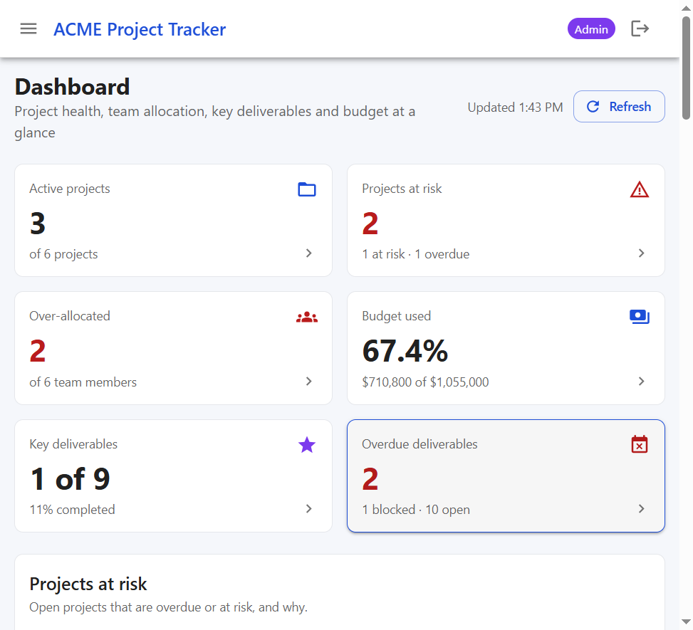
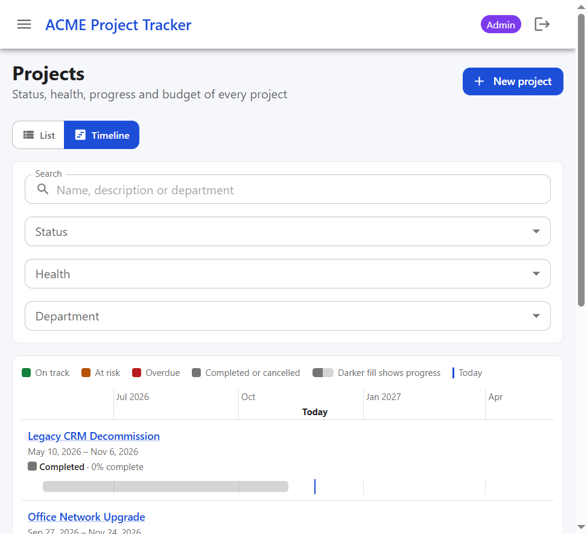
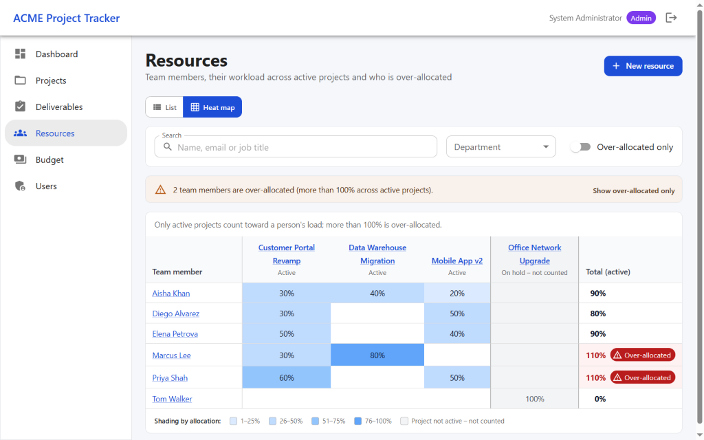
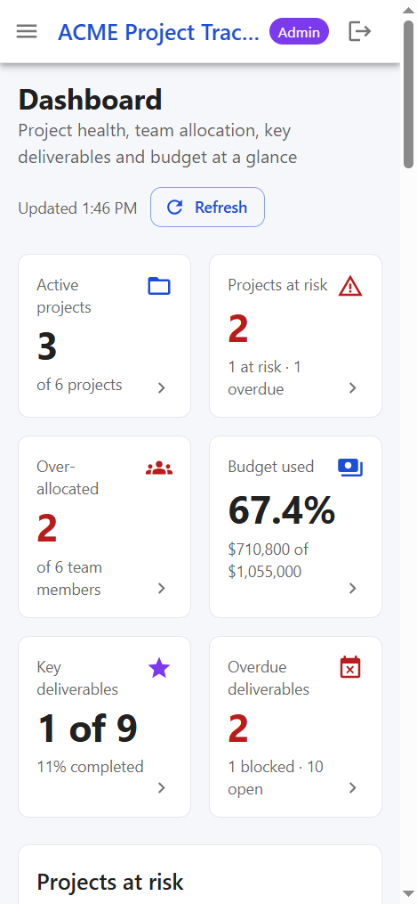

# Nexora — Enterprise Project & Resource Tracker

A centralized project management and tracking platform originally architected for ACME Inc. It gives project managers and team leads real-time visibility into **project health, resource utilization, deliverable dependency chains, and budget burn** — with full CRUD, server-side search and filters, 4-tier role-based access control (RBAC), and a responsive UI for desktop and mobile.

| | |
|---|---|
| **Local app (Docker / Dev)** | http://localhost:3000 |
| **API contract** | [docs/API.md](docs/API.md) |
| **Testing guide & results** | [docs/TESTING.md](docs/TESTING.md) |
| **Resume & interview write-up** | [docs/RESUME_WRITEUP.md](docs/RESUME_WRITEUP.md) |

### Demo accounts (seeded on first start)

| Role | Email | Password | Permissions |
|---|---|---|---|
| **Admin** | `admin@acme.com` | `Admin@123` | Full access, including managing users and roles |
| **Manager** | `manager@acme.com` | `Manager@123` | Full CRUD on projects, deliverables, resources, allocations, and expenses |
| **Contributor** | `contributor@acme.com` | `Contributor@123` | Create and update records (no delete) |
| **Viewer** | `viewer@acme.com` | `Viewer@123` | Read-only access across all views |

> These are local/demo credentials for evaluation. In a production deployment, change them via the Users page or disable seeding.

---

## Screenshots

| Executive Dashboard (Desktop) | Projects Timeline |
|---|---|
|  |  |

| Resources Heat Map | Responsive Mobile Layout (375px) |
|---|---|
|  |  |

## What's new – UX upgrade

A second iteration on top of the workshop requirements: a faster first visit, shorter paths to the
right list, two visual views and fewer planning mistakes. Before/after test numbers:
[docs/TESTING.md › Latest results](docs/TESTING.md#latest-results).

| | What changed | Where to see it |
|---|---|---|
| **Speed you can feel** | The login page pre-warms the database (public `GET /health/db`) while you type; a sign-in or data load that takes over 3 s shows *"Waking up the database – the first request after a quiet period can take up to 20 seconds."* | Login page on AWS after a quiet period |
| | If the database dropped the idle connection, the API reconnects and retries once, before the request runs; CloudFront now waits up to 60 s for the API (was 30 s) | The first request after a pause answers instead of failing |
| | Lambda memory 512 MB (was 128 MB). Measured on AWS: warm login **0.33–0.45 s** (was ~1.2 s); a database wake-up answered in **16.8 s** | Sign in |
| **Find things faster** | Dashboard KPI cards are links to the matching filtered list, and the list matches the card's number (checked as admin, contributor and viewer) | Dashboard → click a card, e.g. *Projects at risk* |
| | Filters live in the URL on Projects, Deliverables and Resources: reload, Back and shared links keep them | Filter a list, open a record, press Back |
| | Health filter *At risk or overdue* (`GET /projects?health=at_risk,overdue`) | Projects → *Health* |
| | Sortable columns in all 7 tables: ascending → descending → original order, exposed as `aria-sort` (desktop) | Click a column header |
| **See the picture** | Projects timeline: one bar per project from start to end date, coloured by health with text labels, a darker progress fill and a *Today* marker | Projects → *List \| Timeline* (`#/projects?view=timeline`) |
| | Resources heat map: people × projects, only active projects count, *Over-allocated* marker; scrolls sideways in its own keyboard-reachable region | Resources → *List \| Heat map* (`#/resources?view=heatmap`) |
| **Fewer mistakes** | Urgency labels next to due and end dates – *Due tomorrow*, *Ends in 3 weeks*, *5 days overdue* – in UTC calendar days; none for completed or cancelled work | Projects and Deliverables lists, project page, deliverable details, dashboard |
| | Allocation what-if: *"Priya Shah: 60% now → 110% after this change"* plus an over-allocation warning, by the API's rule; it never blocks saving | *New allocation* on a project's *Team* tab or a person's page |
| **Quality & security** | The repository's GitHub *Security Check - Python* (bandit) passes – 742 findings before, 0 now: `backend/.bandit` excludes the tests, 19 reviewed `# nosec` annotations with reasons, the demo-data script accepts only http(s) URLs; bandit pinned in `requirements-dev.txt` | GitHub → Actions; [run it locally](docs/TESTING.md#how-to-run) |
| | Two independent reviews – correctness/contracts, and UX/accessibility/responsive in a real browser at 375/768/1366 px – applied 16 fixes | [docs/TESTING.md › Review findings](docs/TESTING.md#review-findings-fixed-ux-upgrade) |

---

## 1. The business questions and where they are answered

| Question | Where in the app | API |
|---|---|---|
| What is the current status of each active project? | Dashboard → *Active projects* (the KPI card opens the filtered list); Projects list (status, health, progress, budget; sortable); Projects → *Timeline* | `GET /dashboard`, `GET /projects?status=active` |
| Which projects are at risk of missing their deadlines? | Dashboard → *Projects at risk* KPI card and section (with reasons); Projects → Health *At risk or overdue*; Projects → *Timeline* (health colours, *Today* marker); "Ends in …" / "… overdue" labels | `GET /projects?health=at_risk,overdue` |
| How are resources allocated across projects? | Resources → *Heat map* (people × projects); Project → *Team* tab; Resource details → *Project allocations* | `GET /resources` + `GET /allocations`, `GET /allocations?project_id=…`, `GET /resources/{id}` |
| What are the key deliverables and their completion status? | Dashboard → *Key deliverables* KPI card and section; Deliverables → *Key deliverables only* (with due-date labels) | `GET /deliverables?is_key=true` |
| Which team members are over-allocated across multiple projects? | Dashboard → *Over-allocated* KPI card and section; Resources → *Over-allocated only*; Resources → *Heat map* (*Over-allocated* marker); what-if preview before an allocation is saved | `GET /resources?over_allocated=true` |
| What is the dependency chain between deliverables? | Deliverable details → *Depends on*, full *Dependency chain*, *Blocks* (each with its due-date label) | `GET /deliverables/{id}` |
| How much budget has been consumed versus planned for each project? | Dashboard → *Budget used* KPI card → Budget page (sortable per-project table); Dashboard → *Budget*; Project → *Budget* tab | `GET /projects`, `GET /expenses` |

### Business rules

* **Progress %** = completed deliverables ÷ all deliverables of the project.
* **Health** (planned / active / on-hold projects; closed projects have none):
  * **Overdue** – today is past the project end date.
  * **At risk** – any deliverable is overdue or blocked, **or** the share of the schedule that has
    elapsed is more than **20 points** ahead of progress %.
  * **On track** – otherwise. Every triggered rule is listed as a reason.
* **Over-allocated** – a person's allocation % across **active** projects adds up to more than 100%
  (allocations to planned/on-hold projects are kept but do not count yet).
* **Budget** – planned budget is set on the project; consumed = sum of its expenses;
  used % = consumed ÷ planned; *over budget* when consumed > planned.
* **Dependencies** – a deliverable can depend on any other deliverable (also across projects);
  self-dependencies and circular chains are rejected.
* "Today" is the current **UTC** date.

---

## 2. Architecture

```
                        ┌──────────────────────── AWS ────────────────────────┐
 Browser                │  CloudFront ──┬── /*               → S3 (React build) │
 (React + MUI) ─HTTPS──▶│               └── /api/pm-service/* → Lambda URL      │
                        │                                        │ Python 3.13   │
                        │                                        ▼               │
                        │                              Aurora PostgreSQL (SSL)   │
                        └─────────────────────────────────────────────────────────┘

 Local:  Vite :3000 ──▶ dev proxy :3001 ──▶ LocalStack Lambda (hot reload) ──▶ PostgreSQL :5432
```

**Backend – one Lambda, organised by domain (`backend/pm-service`)**

```
function.py                  Lambda entry point
app/main.py                  request pipeline: route → transaction (reconnect once) → authenticate → authorize → handler
app/core/                    router, HTTP/JSON, errors, validation (pydantic), db, schema.sql, clock
app/auth/                    login/refresh/me, JWT, bcrypt, central permission matrix, seeding
app/<domain>/                users, projects, deliverables, resources, allocations, expenses, dashboard
    routes.py  (HTTP)  →  service.py (business rules)  →  repository.py (parameterized SQL)
    schemas.py (request validation)
app/projects/health.py       health / progress / budget rules (pure functions)
app/projects/metrics.py      per-project aggregates shared by projects and dashboard
app/resources/utilization.py over-allocation rule shared by resources, allocations and dashboard
```

**Frontend – feature folders (`frontend/src`)**

```
services/     apiClient (JWT, silent refresh, ApiError), healthApi (database wake-up) + one module per API resource
context/      AuthProvider (session, permissions), NotificationProvider (toasts)
components/   AppLayout (responsive nav), DataTable (table ⇄ cards, sortable columns), FormDialog, ConfirmDialog,
              FilterBar, ViewSwitch (List | Timeline / Heat map), StatCard (KPI link), DueDate (urgency label),
              StatusChip, PercentBar, route guards, state views (with the slow-request hint)
pages/        login, dashboard, projects (+ timeline), deliverables, resources (+ heat map, allocation what-if),
              budget, users
hooks/        useUrlFilters (filters and views in the URL), useDelayedFlag (hint after 3 s), …
utils/ theme.js
```

### Request lifecycle
1. `parse_event` normalises the Lambda Function URL event (strips `/api/pm-service` when called
   through CloudFront).
2. The router resolves the route (404 / 405) and its declared permission.
3. One database transaction per request. If the database closed the container's idle connection, it
   is replaced and the transaction opened again – once, before anything of the request has run. Then
   the token is verified, the user is re-read from the database (role changes and deactivation apply
   immediately), the permission is checked (403), and the handler runs. Any error rolls the whole
   request back.
4. Every error is returned as `{"error": {"code", "message", "details"}}` with the right status
   (400/401/403/404/405/409/500).

---

## 3. Design decisions and trade-offs

| Decision | Why | Trade-off |
|---|---|---|
| **One Lambda (`pm-service`) with domain modules** instead of one Lambda per entity | No copy-pasted DB/auth code (Terraform packages each service folder separately), one cold start, one connection per container, one deploy | All domains scale together; splitting later is straightforward because each domain is already isolated |
| **PostgreSQL schema applied on cold start** (`CREATE … IF NOT EXISTS`, advisory lock) | Zero manual setup locally and in AWS (Aurora is only reachable from inside the VPC) | Not a migration tool; schema changes beyond additive ones would need one (e.g. Alembic) |
| **Computed fields on read** (health, progress, spend, utilization) | Always consistent with the data; no counters to keep in sync | Aggregation queries per list request (single query per request, indexed) |
| **JWT access (30 min) + refresh (7 days) tokens, bcrypt passwords** | Stateless auth that suits Lambda; silent refresh in the UI | Refresh tokens cannot be revoked individually (deactivating a user blocks them immediately though) |
| **Permissions defined once** in `app/auth/permissions.py`, sent to the UI via `/auth/me` | UI hides what a role cannot do; API enforces everything | — |
| **Tokens in `localStorage`** | Simple for a static S3/CloudFront site | Exposed to XSS; httpOnly cookies would need cookie/CSRF handling on the API |
| **Hash-based routes (`/#/projects`)** and **no CloudFront 404→index.html rule** | That rule applies to every origin and turned API 404s into "200 + HTML" | URLs contain `#` |
| **Validation in both layers** (pydantic on the API, same rules in forms) | Immediate feedback in the UI; the API is the source of truth | Rules are duplicated on purpose |
| **bcrypt cost 10 on a 512 MB Lambda** (was 128 MB) | Secure default; CPU scales with Lambda memory, so bcrypt and cold starts got faster: warm login 0.33–0.45 s on AWS (was ~1.2 s), other calls ≈ 70 ms | 4× the price per millisecond, partly offset by shorter runs – negligible at this traffic |
| **URL as the single source of truth for filters and views** (`useUrlFilters`, `ViewSwitch`) | Reload, Back/Forward, shared links and the dashboard's KPI links all show the same list; no second copy of the filters to keep in sync | A filter change replaces the history entry, so Back leaves the page rather than undoing one filter; invalid values in a link are ignored |
| **Client-side sorting of the rows already loaded** | Instant, no API change, works with every filter (lists are not paginated) | Desktop tables only (the mobile cards keep the API order); the sort order is not kept in the URL |
| **Urgency rules in whole UTC calendar days** | Same "today" as the API's overdue and health rules; the dashboard words dates against its snapshot date (`generated_at`), so its labels match the lists it was sent | Far from UTC a label changes at a local time other than midnight (e.g. 05:30 IST) |
| **What-if mirrors the backend rule** (only active projects count; above 100% is over-allocated) | A warning before saving, with no extra request; it never blocks, because the API allows over-allocation | The rule lives in both layers (like validation); it uses the totals loaded when the dialog opened |
| **Wake-up ping + retry once + 60 s CloudFront timeout** | Aurora Serverless v2 pauses at 0 ACU: the login page starts the resume while the user types; a connection the database dropped is replaced once *before* the request runs, so nothing runs twice; two 25 s connection attempts end inside CloudFront's 60 s | The first request after a pause still takes ~15–20 s (the hint explains it); a failure after the handler started is not retried |
| **bandit configuration**: tests excluded (`backend/.bandit`), application findings reviewed in place (`# nosec <id> # reason`) | GitHub runs `bandit -r ./backend`; plain `assert` and fake passwords are how tests work; each of the 19 annotations says why it is safe: 15 SQL f-strings that only insert constant column lists (values are bound parameters), 3 strings that are not secrets (the documented demo login, the local-only JWT placeholder, the token type "Bearer") and the seed script's `urlopen`, which only gets http(s) URLs | An annotation must be re-checked when its line changes; CI's Python 3.11 skips `app/core/validation.py` (see known gaps) |

### Changes made to the workshop scaffolding (found while setting up)
1. `bin/start-dev.sh` – `pip` on the VDI runs Python 3.14 while Lambda runs 3.13, so the hot-reload
   dependency install failed silently (`No module named 'psycopg'` → 500). It now installs wheels
   for the Lambda runtime and reports failures.
2. `bin/start-dev.sh` – the "is React already running?" check matched ports 30000–30003 used by
   JetBrains IDEs, so the frontend never started. It now matches port 3000 exactly.
3. `bin/proxy-server.js` – forwarded no `Authorization` header and answered CORS preflights with
   `Allow-Headers: *` (which browsers do not apply to `Authorization`), so authenticated calls failed locally.
4. `infra/cloudfront.tf` – removed the distribution-wide 404 → `/index.html` (200) rule.
5. `infra/main.tf`, `infra/locals.tf` – a random 256-bit `JWT_SECRET` is generated by Terraform and
   passed to the Lambda.
6. Locally, LocalStack Lambdas live in **us-east-1** (not `$AWS_REGION`), so log commands need
   `--region us-east-1`.
7. `frontend/package.json` – `eslint.config.js` imported `eslint-plugin-react-hooks` and
   `eslint-plugin-react-refresh`, which were not installed, so `npm run lint` failed; both were added.
8. `infra/cloudfront.tf` – the API origin's read timeout is 60 s (`origin_read_timeout`; the default
   is 30 s, and 60 s is the maximum without a quota increase), so a request that waits for Aurora to
   resume gets the API's answer instead of a CloudFront 504.
9. `infra/lambda.tf` – Lambda memory 128 → 512 MB (CPU scales with memory: faster bcrypt and cold
   starts). `infra/locals.tf` only has `terraform fmt` alignment changes.

---

## 4. Run it locally

### Option A: One-Command Docker Stack (Recommended)

Requires [Docker Desktop](https://www.docker.com/products/docker-desktop/). Starts PostgreSQL 16, the Python API (`:3001`), and the Nginx-served React app (`:3000`):

```bash
docker compose up -d --build
```

Optional — seed a realistic demo portfolio (6 projects across all statuses/health states, deliverable dependency chains, 2 over-allocated team members, and 1 over-budget project):

```bash
python backend/scripts/seed_demo_data.py http://localhost:3001
```

Open **http://localhost:3000** and sign in with any of the demo accounts above.

### Option B: Native Python + Vite Dev Mode (Hot Reload)

1. Start PostgreSQL:
   ```bash
   docker compose up -d postgres
   ```
2. Start the backend dev server (`backend/pm-service/dev_server.py` wraps the AWS Lambda handler):
   ```bash
   cd backend
   python -m venv .venv
   # Windows: .venv\Scripts\activate   |   macOS/Linux: source .venv/bin/activate
   pip install -r requirements-dev.txt
   set POSTGRES_PASS=postgres   # export POSTGRES_PASS=postgres on macOS/Linux
   python pm-service/dev_server.py
   ```
3. Start the frontend dev server (Vite proxies `/api/*` to `http://localhost:3001`):
   ```bash
   cd frontend
   npm install
   npm run dev
   ```

Useful API check:

```bash
curl -s -X POST http://localhost:3001/api/pm-service/auth/login \
     -H "Content-Type: application/json" -d '{"email":"admin@acme.com","password":"Admin@123"}'
```

## 5. Tests

| Layer | Tool | Command |
|---|---|---|
| Backend unit + integration (real PostgreSQL) | pytest, pytest-cov | `cd backend && pytest --cov=app` |
| Frontend components + API client | Vitest, React Testing Library | `cd frontend && npm test -- --run` · coverage: `npm run test:coverage` |
| End-to-end (critical user journeys) | Cypress 16 | `cd e2e && npm install && npm run e2e` |
| Load | Artillery 2 | `cd e2e && npx artillery run load/api-load.yml` |
| Lint / format | ruff (Python), ESLint (React) | `cd backend && ruff check . && ruff format --check .` · `cd frontend && npm run lint` |
| Security (static analysis) | bandit 1.9.4 | `bandit --ini backend/.bandit -r backend/pm-service backend/scripts` |

**Verified results:**
- **Backend (`pytest`):** **949 passed**, **99% code coverage** against PostgreSQL 16.
- **Security (`bandit`):** **0 issues** across 2,753 lines of Python code.
- **Frontend (`Vitest` / `ESLint` / `vite build`):** 57 test files (676 tests) + clean ESLint + production build verified.
- **E2E (`Cypress` & `axe-core`) / Load (`Artillery`):** 72 E2E tests across 10 specs, 0 serious/critical WCAG 2.1 AA violations, and 3,420 load-test requests at 100% success (p95 257 ms) documented in [docs/TESTING.md](docs/TESTING.md).

### Repository layout

```
backend/pm-service/     AWS Lambda handler + local dev_server.py + Dockerfile + domain modules
backend/scripts/        Demo data seeder (seed_demo_data.py)
backend/tests/          949 pytest unit + integration tests
frontend/               React 19 + Vite + Material UI app + Dockerfile
infra/                  Terraform IaC for AWS Serverless (CloudFront, S3, Lambda, Aurora PostgreSQL)
e2e/                    Cypress E2E specs & Artillery load tests
docs/                   API.md, TESTING.md, RESUME_WRITEUP.md, screenshots/
docker-compose.yml      One-command local PostgreSQL + Backend + Frontend stack
```

## 6. Deploy to AWS

```bash
source ~/.bashrc
./bin/deploy-backend.sh     # Terraform: Lambda, Aurora PostgreSQL, S3, CloudFront, JWT secret
./bin/deploy-frontend.sh    # builds the React app with the CloudFront URL and uploads it to S3
```

Do not run `start-dev.sh` while a deploy is running (both use the Terraform folder in `infra/`).
Verify:

```bash
curl -s https://<cloudfront-domain>/api/pm-service/health      # {"status": "ok", ...}
curl -s https://<cloudfront-domain>/api/pm-service/health/db   # {..., "database": "ok"} – also wakes the database
```

The first request after a long idle period takes ~15–20 s (Aurora Serverless resuming from 0 ACU,
plus a Lambda cold start). The login page starts that wake-up as soon as it opens, a sign-in or data
load that takes over 3 s shows *"Waking up the database…"*, and CloudFront waits up to 60 s for the API. Measured on AWS after
the upgrade: a database wake-up answered in 16.8 s, warm login 0.33–0.45 s; other calls take ~70 ms.

## 7. Assumptions and known gaps

* Single currency (USD) and UTC business dates.
* Allocation % is a share of one person's full-time capacity; no calendar-based scheduling.
* No pagination (lists are small for a department-level tool); search and filters are server-side.
* No password-reset e-mails, audit log, real-time push or offline/PWA support (out of the stated scope).
* Refresh tokens are stateless (see trade-offs).
* An admin cannot demote, disable or delete themselves, but there is no "last active admin" lock:
  two admins acting on each other at the same moment could leave none.
* Dashboard deliverable counters and lists include deliverables of completed/cancelled projects
  (same as `GET /deliverables`); only the budget figures exclude cancelled projects.
* The dashboard's queries run in one READ COMMITTED transaction, so under concurrent writes its
  sections can reflect slightly different moments.
* Sorting is client-side on the desktop tables and not kept in the URL: a reload, Back or a shared
  link shows the API order.
* The dashboard words due and end dates against its snapshot date (the UTC date of `generated_at`),
  while the API takes "today" when the request starts: for a request straddling midnight UTC its
  labels could be one day off.
* The "Waking up the database" hint is time-based (a sign-in or data load over 3 s), so a request
  that is slow for another reason shows it too.
* GitHub's bandit job runs on Python 3.11, which cannot parse `app/core/validation.py` (PEP 695
  generics, Python 3.12+) and skips it; on Python 3.13 (the Lambda runtime) the file is scanned and
  passes.
* Below about 1264 px wide (with the side menu shown) the Projects table scrolls sideways inside its
  own box; the page itself never scrolls.
